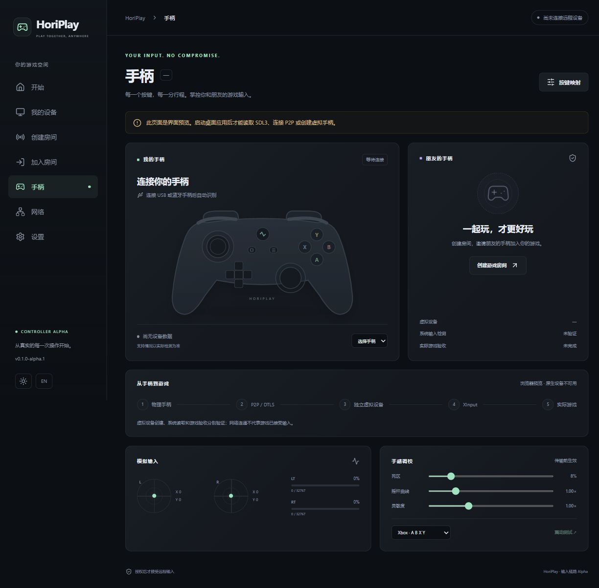

# HoriPlay

**原生远程手柄输入工程 Alpha · v0.1.0-alpha.1**

[English](README.en.md) · [架构](docs/ARCHITECTURE.md) · [驱动调研](docs/VIRTUAL-GAMEPAD.md) · [运行指南](docs/GETTING-STARTED.md) · [验收记录](docs/VALIDATION.md) · [输入性能实测](docs/PERFORMANCE.md)

main 新增输入性能优化：移除 8 ms 发送等待、只保留最新连续状态、缓存设备信息。调度对照数据及 CPU 未显著改善的测量边界见上述性能记录。已发布的 alpha.1 安装包不包含这些后续改动。

下载：[v0.1.0-alpha.1 Release](https://github.com/hhhoratioxu/HoriPlay/releases/tag/v0.1.0-alpha.1) · [Windows EXE](https://github.com/hhhoratioxu/HoriPlay/releases/download/v0.1.0-alpha.1/HoriPlay-windows-x64-setup.exe) · [Windows MSI](https://github.com/hhhoratioxu/HoriPlay/releases/download/v0.1.0-alpha.1/HoriPlay-windows-x64.msi) · [Apple Silicon DMG](https://github.com/hhhoratioxu/HoriPlay/releases/download/v0.1.0-alpha.1/HoriPlay-macos-arm64.dmg) · [Intel DMG](https://github.com/hhhoratioxu/HoriPlay/releases/download/v0.1.0-alpha.1/HoriPlay-macos-x64.dmg)。应用安装包未签名，macOS 未公证；仅 Windows EXE 执行了安装启动检查。

HoriPlay 的目标是 Windows / macOS 低延迟远程游戏与独立手柄同玩。**当前交付聚焦真实输入链路，不是已达到最终验收的可玩串流软件。视频、音频和真实双人游戏验收尚未完成。**



已实现的生产代码：

- SDL3 原生手柄枚举、热插拔轮询、名称/VID/PID、电量、连接类型、15 个标准按钮、四轴与两路模拟扳机。能力来自 SDL 属性，不能从设备名称推断。
- 死区、径向曲线、灵敏度和按钮映射；真实状态驱动 React / Tauri 2 手柄测试页面。
- 56 字节版本化输入协议，含 Session ID / Controller ID / 序号 / 时间戳 / 插槽 / 完整状态；会话和插槽授权、去重、防重放。
- 原生 Rust WebRTC ICE / STUN / TURN / Trickle ICE；高频无序零重传状态通道与可靠有序关键事件通道；旧状态不进入应用业务队列。
- Axum / WebSocket 房间服务；10 分钟新加入有效期；访客先请求、主机批准连接，再单独授予输入权限。
- 邀请码密钥在端点生成；SDP（含 DTLS 指纹）与 ICE 消息用 HMAC-SHA256 验证，信令服务器只接收加入散列；公网强制 WSS。
- Windows VIIPER 独立进程后端：创建 Xbox 360 设备、20 字节输入、双马达反馈、撤权/退出归零与移除。创建后必须由独立 XInput 读取确认请求插槽出现，才授予输入。
- 250ms 新鲜有效输入看门狗、断线清理、队列边界、独立 XInput Test CLI 和真实 WebRTC 回环基准。

Windows 后端要求用户**自行明确同意安装**上游签名 USB/IP 驱动并运行 VIIPER。HoriPlay 不安装内核驱动、不关闭签名检查、不捆绑 ViGEmBus，也不把键盘映射称为虚拟手柄。

## 快速构建

需要 Rust stable、Node.js 22+。Windows 正式安装包使用 MSVC + Windows SDK；本机缺少 MSVC 时可用已有 GNU 工具验证核心代码。

```powershell
.\scripts\fetch-sdl.ps1
$env:HORIPLAY_SDL3 = (Resolve-Path .\runtime\SDL3.dll).Path
cargo test --locked
cargo run -p horiplay-cli -- gamepad-test --seconds 15
cargo run -p horiplay-signaling
# 另一个终端
cd apps/desktop
npm ci
npm run tauri dev
```

在中文路径使用 GNU 工具链时，将构建输出置于英文目录，防止 dlltool 路径编码错误：

```powershell
$env:CARGO_TARGET_DIR = 'D:\CodeX\Builds\HoriPlay'
cargo +stable-x86_64-pc-windows-gnu test --locked
```

macOS：

```bash
bash scripts/fetch-sdl-macos.sh arm64 # Intel 改为 x86_64
export HORIPLAY_SDL3="$PWD/runtime/libSDL3.0.dylib"
cargo test --locked
cd apps/desktop && npm ci && npm run tauri dev
```

## 当前边界

| 能力 | 状态 |
|---|---|
| SDL3 真实读取、模拟量、映射 | 已实现；每款实体手柄待逐一验收 |
| WebRTC 两通道 / 强制 TURN | 本机真实协议测试；跨不同网络待验收 |
| Windows Xbox 360 后端 | 已实现；签名驱动和实体双人游戏待验收 |
| 逻辑插槽 1–4 | 防冲突已实现；第一版同时一名访客 / 一个远程手柄 |
| XInput 编号 | 由 Windows 分配；请求编号未出现就拒绝授权，不伪造编号 |
| 震动 | 后端反馈与回传实现；实体震动待验收 |
| macOS Guest | 源码与构建流程；实体 Mac / USB / 蓝牙待验收 |
| macOS Host 虚拟控制器 | 未实现；CoreHID / entitlement 调研见文档 |
| 视频 / 音频 / 键鼠 | 未实现 |
| 1080p60 / 120 FPS / HDR | 无测试数据，不宣称支持 |
| ICE Restart / 自动重连 / 多访客 | 未实现；失联结束会话并归零 |
| 签名自动更新 | 未启用；未配置发布签名密钥，不接受未签名更新 |

MIT 适用于本仓库自有代码。独立依赖的许可与分发边界见 [THIRD-PARTY.md](THIRD-PARTY.md)。本阶段不绕过 Phase 4 的实体游戏验收来宣称完整 Remote Play。
